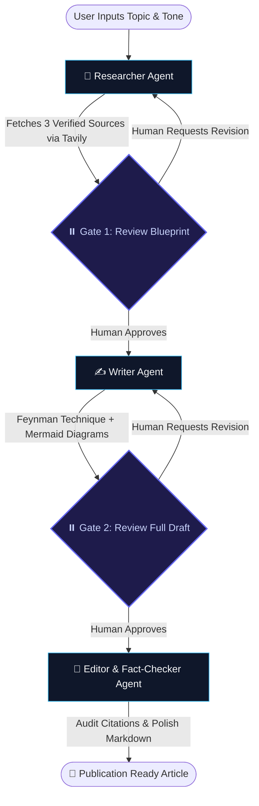

# 🚀 PostGraph — Autonomous Multi-Agent Technical Publishing Engine

> A state-driven multi-agent AI system that transforms raw technical topics into deeply intuitive, publication-ready  articles using the **Feynman Technique**, verified web research, human-in-the-loop review gates, and live visual diagrams.

---

## 🌟 Overview

Writing high-quality technical content requires deep domain research, engaging real-world analogies, verified citations, and architectural diagrams. **PostGraph** orchestrates a team of specialized AI agents running on **LangGraph** to automate the end-to-end editorial pipeline while keeping human editorial judgment in the loop.

Articles are written using the **Feynman Technique**: each concept is explained in plain language with real-world analogies and diagrams, and no jargon is left unexplained, so readers come away with genuine understanding and not just definitions.

Unlike naive single-prompt LLM wrappers, PostGraph utilizes a **deterministic state machine** with:
- **Human-in-the-Loop Review Checkpoints** (`interrupt()`) at both outline and draft stages.
- **Guardrailed Revision Loops** (preventing infinite loops with `max_revisions`).
- **Resilient Multi-Provider Fallbacks** (Groq LLaMA 3.3 70B &rarr; Google Gemini Flash 1.5).
- **Interactive Live Markdown Workspace** with instant live-sync editing, slugified export, and Mermaid 12 diagram rendering.

---

## 🏛️ Architecture & Workflow



### The Multi-Agent Pipeline

| Agent / Gate | Responsibility | Key Output |
| :--- | :--- | :--- |
| **🔬 Researcher** | Queries Tavily for real-world technical sources; extracts primary facts and synthesizes an architectural blueprint (~200 words). | Verified clickable sources, target developer angle, and structural plan. |
| **⏸️ Gate 1 (Human Review)** | Halts graph execution to let the user inspect the outline, source links, and target angle. | Approves or loops back with editorial feedback. |
| **✍️ Writer** | Expands the blueprint into a 1,000–1,400 word masterclass using the **Feynman Technique** (everyday analogies, intuitive mental models, rule of thumb, and Mermaid diagrams). | Complete long-form technical draft with visual workflows. |
| **⏸️ Gate 2 (Human Review)** | Halts execution to review the full draft, inspect diagrams, and request adjustments. | Approves or provides targeted revision instructions. |
| **🧐 Editor & Fact-Checker** | Audits technical claims against the research sources, verifies active citations, and polishes typography. | Final production-ready Markdown article. |

---

## ✨ Key Features

- **🎓 Feynman Technique Pedagogical Tone:** Complex engineering concepts (e.g., event loops, distributed consensus, memory barriers) are taught using intuitive real-world mental models before diving into mechanics.
- **📊 Visual Diagrams Over Toy Code:** Generates contextual **Mermaid.js flowcharts** that explain runtime lifecycles and architectural flows rather than repetitive boilerplate code snippets.
- **⚡ Dual LLM Provider Architecture:**
  - **Primary:** Groq (`llama-3.3-70b-versatile`) delivering blazing fast generation (~250+ tokens/sec).
  - **Fallback:** Google Gemini (`gemini-1.5-flash`) automatically invoked if rate limits or provider downtime occur.
- **🔁 Guardrailed Human-in-the-Loop:** LangGraph interrupts pause execution at Gate 1 and Gate 2. If the user requests revisions, the graph loops back with feedback while strictly enforcing `max_revisions` to avoid runaway costs.
- **📝 Live On-Screen Markdown Editor:** Dual-tab workspace ("Preview" and "Live Edit") allowing on-the-fly content tweaks before downloading or copying.
- **📥 Clean Markdown Export:** Automatically slugifies the article headline into a clean filename (e.g., `the-event-loop-in-javascript.md`) for instant download.

---

## 🛠️ Tech Stack

### Backend
- **Python 3.12** & **FastAPI** — High-performance asynchronous REST API.
- **LangGraph** — Cyclic state machine orchestration with checkpointing and interrupts.
- **LangChain Core** — LLM prompt templating, schema validation, and fallback chains.
- **Groq SDK** & **Google Generative AI** — Multi-provider LLM inference.
- **Tavily Python** — Search API optimized for technical research and source verification.
- **Loguru** — Structured, contextual backend logging.
- **uv** — Fast Python package manager and dependency resolver.

### Frontend
- **React 18** & **Vite** — Ultra-responsive Single Page Application.
- **Tailwind CSS** — Modern dark-mode editorial workspace.
- **React Markdown 9** & **Remark GFM** — Safe, GitHub-flavored Markdown rendering with custom typography.
- **Mermaid 12** — Dynamic client-side diagram rendering with auto-sanitization.
- **Lucide React** — Minimalist UI iconography.
- **pnpm** — Fast, disk-efficient JavaScript package manager.

---

## 📁 Repository Structure

```text
PostGraph/
├── backend/
│   ├── app/
│   │   ├── agent/
│   │   │   ├── graph/             # StateGraph definition, state schema, and routing logic
│   │   │   ├── llm/               # LLM factory with Groq -> Gemini fallback
│   │   │   ├── nodes/             # Researcher, Writer, and Editor node implementations
│   │   │   └── tools/             # Tavily web search integration
│   │   ├── api/v1/                # REST endpoints, controllers, and Pydantic schemas
│   │   ├── core/                  # Application configuration and settings
│   │   ├── repositories/          # LangGraph checkpoint repository (MemorySaver / Postgres)
│   │   └── services/              # Workflow initiation and resumption service
│   ├── main.py                    # Uvicorn entrypoint with dynamic port binding
│   ├── pyproject.toml             # Python dependencies and metadata (uv lockfile)
│   └── uv.lock
│
├── frontend/
│   ├── src/
│   │   ├── api/                   # Axios / fetch client with dynamic API base URL
│   │   ├── components/
│   │   │   ├── common/            # Header, Navigation, and Layout
│   │   │   ├── forms/             # StartBlogForm with style/tone selectors
│   │   │   ├── review/            # Gate 1 & Gate 2 interactive approval panels
│   │   │   └── viewer/            # MarkdownViewer, live editor, and MermaidDiagram
│   │   ├── pages/                 # CreateBlogPage and BlogWorkspacePage
│   │   └── main.jsx
│   ├── package.json
│   ├── pnpm-lock.yaml
│   ├── tailwind.config.js
│   └── vercel.json                # Single-page application route rewrites for Vercel
└── README.md
```

---

## 🚀 Getting Started Locally

### Prerequisites
- **Python 3.12+** and [**uv**](https://github.com/astral-sh/uv)
- **Node.js 18+** and [**pnpm**](https://pnpm.io/)
- API Keys:
  - [Groq API Key](https://console.groq.com)
  - [Google Gemini API Key](https://aistudio.google.com)
  - [Tavily API Key](https://tavily.com)

---

### 1. Backend Setup

```bash
# Navigate to backend directory
cd backend

# Create virtual environment and install dependencies
uv sync

# Configure environment variables
cp .env.example .env
```

Open `backend/.env` and insert your credentials:
```env
GROQ_API_KEY=gsk_...
GEMINI_API_KEY=AIza...
TAVILY_API_KEY=tvly-...
ENVIRONMENT=development
LOG_LEVEL=INFO
CORS_ORIGINS=http://localhost:5173
PORT=8000
```

Start the backend server:
```bash
uv run uvicorn main:app --reload --port 8000
```
The API documentation is available at `http://localhost:8000/docs`.

---

### 2. Frontend Setup

In a new terminal window:
```bash
# Navigate to frontend directory
cd frontend

# Install dependencies
pnpm install

# Configure environment variables
cp .env.example .env
```

Ensure `frontend/.env` points to the local backend:
```env
VITE_API_BASE_URL=http://localhost:8000
```

Start the Vite development server:
```bash
pnpm run dev
```
Open `http://localhost:5173` in your browser.

---

## 🌐 Deployment Guide

PostGraph is pre-configured for cost-effective deployment with **Render** (Backend) and **Vercel** (Frontend).

### Deploying Backend to Render
1. Create a new **Web Service** on [Render](https://render.com) connected to your repository.
2. Configure settings:
   - **Root Directory:** `backend`
   - **Environment:** `Python 3`
   - **Build Command:** `pip install uv && uv sync --frozen`
   - **Start Command:** `uv run uvicorn main:app --host 0.0.0.0 --port $PORT`
3. Add Environment Variables:
   - `GROQ_API_KEY`, `GEMINI_API_KEY`, `TAVILY_API_KEY`
   - `CORS_ORIGINS`: `https://your-frontend.vercel.app`

### Deploying Frontend to Vercel
1. Import the repository into [Vercel](https://vercel.com).
2. Configure settings:
   - **Root Directory:** `frontend`
   - **Framework Preset:** `Vite`
3. Add Environment Variable:
   - `VITE_API_BASE_URL`: `https://your-backend.onrender.com`
4. The included `frontend/vercel.json` automatically handles client-side routing for `/blog/:threadId`.

---

## 🗺️ Planned Roadmap

- [ ] **PostgreSQL Checkpointer:** Replace `MemorySaver` with `AsyncPostgresSaver` (via Neon or Supabase) so in-flight review sessions survive container spin-downs on free-tier hosting.
- [ ] **One-Click Publishing:** Integrations with Hashnode, Dev.to, and Medium APIs.
- [ ] **Custom Style Presets:** Ability to train or prompt custom voice profiles (e.g., Staff Engineer, Casual Explainer, Academic Paper).
- [ ] **Interactive Visual Editor:** In-line editing of Mermaid diagrams with live visual feedback.

---

## 📄 License

Distributed under the MIT License. Feel free to use, modify, and build upon this engine for personal and commercial projects.
